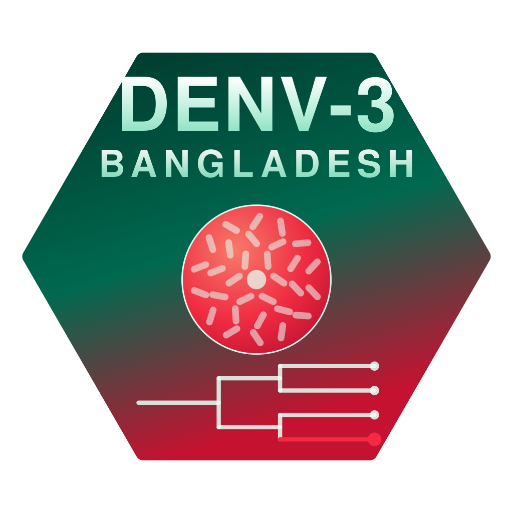
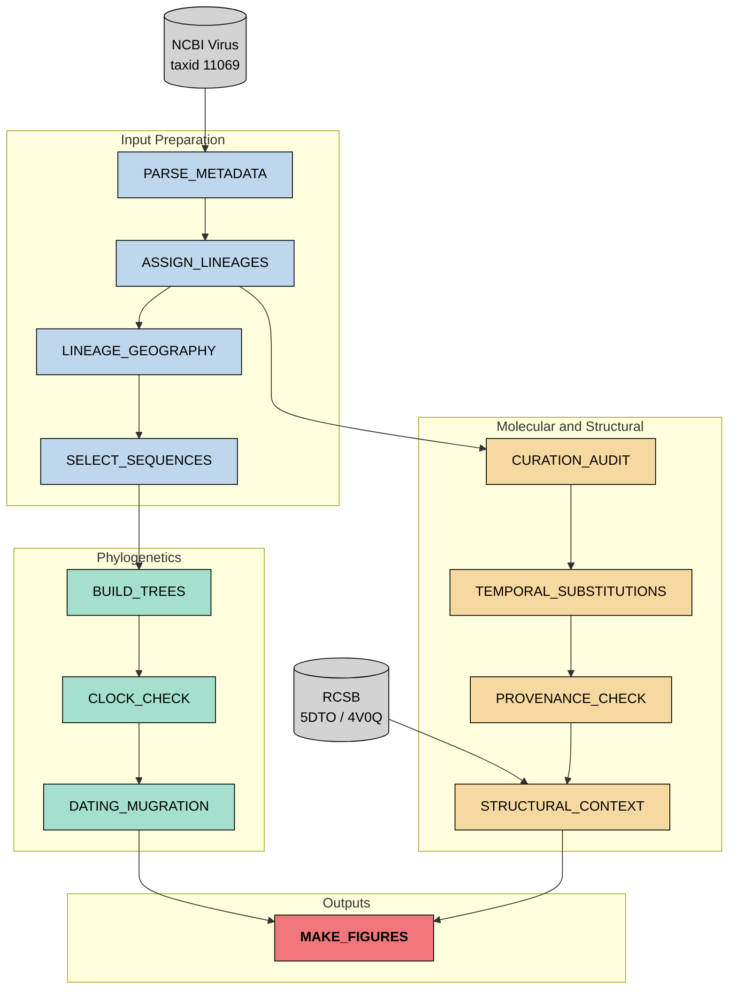
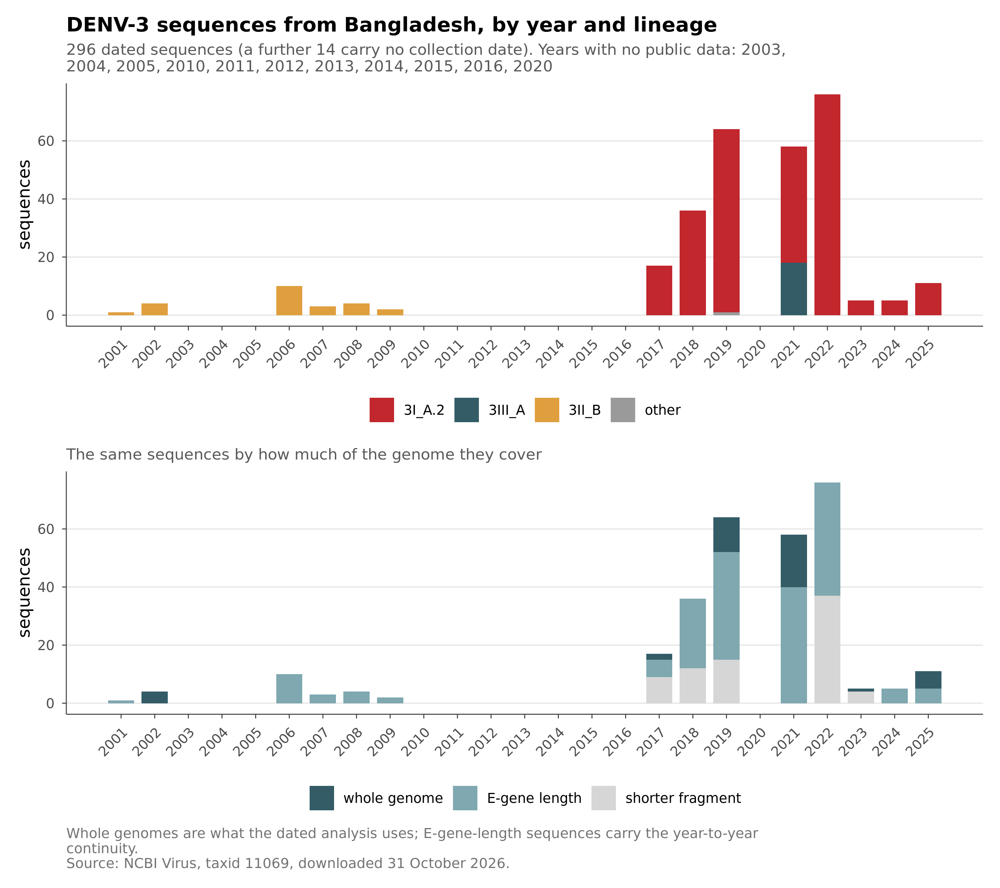
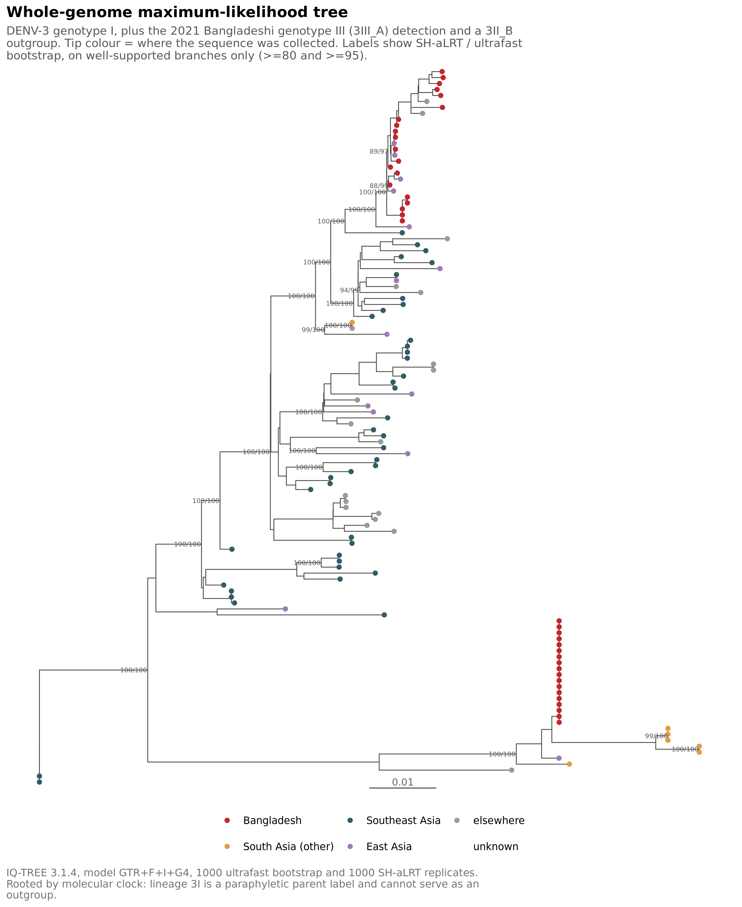
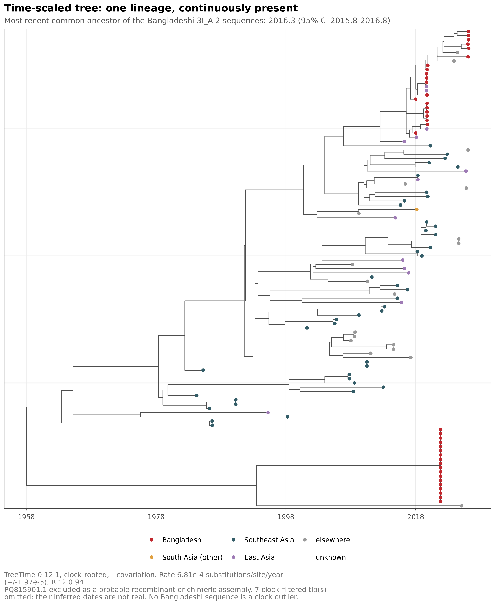
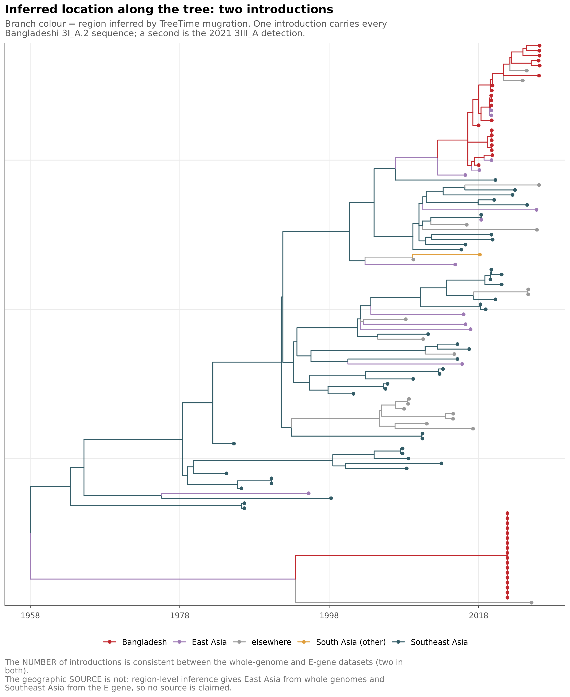
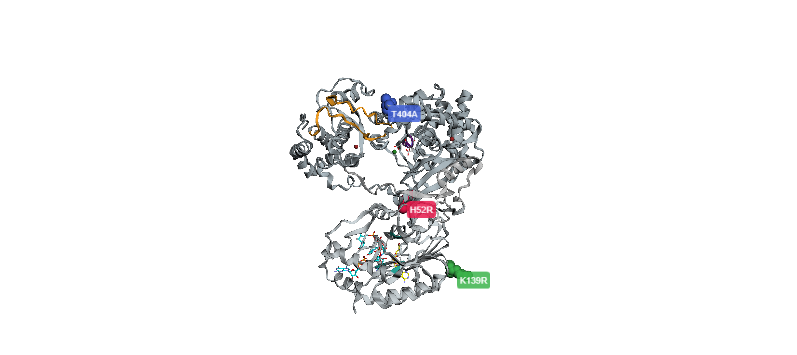

<p align="center">
  
</p>

<h1 align="center">DENV-3-Bangladesh-Genomics</h1>

<p align="center">
  Which dengue virus is behind Bangladesh's 2025–26 surge, and did it come from here?
</p>

------------------------------------------------------------------------

📝 **Blog post:** *(not written yet)*

## What is DENV-3-Bangladesh-Genomics?

DENV-3-Bangladesh-Genomics is a reproducible analysis of the dengue virus serotype 3 lineage driving Bangladesh's 2025–26 outbreak, built from 9,815 public sequences and three DENV-3 crystal structures. Dengue here has shifted serotype — DENV-3 went from about 20% of typed cases in 2024 to about 91.5% in 2026 — which raises the risk of severe disease in people previously infected with a different serotype. No public analysis had identified which lineage was responsible, or whether it had persisted locally or arrived again from abroad. Those two answers point to different responses: domestic surveillance, or border surveillance. This repository answers the question, and then asks whether the virus itself changed while it was here.

## Key Features

This project offers several things beyond the analysis itself:

- **Interactive 3D structure:** The three substitutions that define the lineage, mapped onto DENV-3 NS5 and explorable in the browser
- **Reproducible pipeline:** Nextflow DSL2 with a 17-sequence synthetic test set, tested in CI across Docker and Conda and two Nextflow versions
- **Provenance-first curation:** Every candidate substitution is checked by year, sequencing batch and submitting laboratory before it is believed
- **Decisions on the record:** Every curation choice is a named constant that prints its reason at runtime, and the four claims withdrawn during the project are listed

------------------------------------------------------------------------

## Biological Questions:

1. Which DENV-3 lineages have circulated in Bangladesh since 2017?
2. Do the 2025 viruses descend from earlier Bangladeshi viruses, or from viruses sampled elsewhere?
3. How many separate introductions are supported, and when?
4. Did any amino acid substitution arise and spread while the lineage persisted here?
5. Where do the substitutions that define this lineage sit on the viral proteins?

------------------------------------------------------------------------

## Dataset:

| Accession | Type | Description |
|------------------------|------------------------|------------------------|
| taxid 11069 (NCBI Virus) | Nucleotide sequences | All public DENV-3 sequences, 9,815 downloaded 31 October 2026 |
| 5DTO (RCSB) | Crystal structure | DENV-3 full-length NS5 with cap-0 RNA and SAH, 2.60 Å |
| 4V0Q (RCSB) | Crystal structure | DENV-3 full-length NS5 with SAH, 2.30 Å |
| 1UZG (RCSB) | Crystal structure | DENV-3 E ectodomain, strain H87, 3.50 Å |

Of the 9,815 sequences, 310 are from Bangladesh. Only 39 of those are complete genomes and most of the rest are E-gene or shorter fragments, so the analysis runs on two datasets: a whole-genome set for resolution and dating, and an E-gene set for continuity across years that the whole genomes do not cover. Both structures used for the main result are DENV-3, so no homology modelling was needed.

------------------------------------------------------------------------

## Pipeline Overview:

This project is built as a modular Nextflow DSL2 pipeline. Each stage is a separate process with inputs and outputs; resource limits and parameters are set in `nextflow.config` and the profiles under `conf/`.

```
denv3-bangladesh-genomics/
|-- README.md
|-- main.nf
|-- nextflow.config
|-- environment.yml
|-- .github
|   `-- workflows
|       `-- ci.yml
|-- conf
|   `-- test.config
|-- scripts
|   |-- 00_download.sh
|   |-- 01_parse_metadata.py
|   |-- 02_run_nextclade.sh
|   |-- 02b_summarise_nextclade.py
|   |-- 03_lineage_geography.py
|   |-- 04_select_sequences.py
|   |-- 05_mutation_profile.py
|   |-- 06_build_trees.sh
|   |-- 06b_inspect_trees.py
|   |-- 07_clock_check.py
|   |-- 08_curation_audit.py
|   |-- 09_outlier_and_recombination.py
|   |-- 10_confirm_chimera.sh
|   |-- 11_date_and_introductions.py
|   |-- 12_figures.R
|   |-- 13_robustness.sh
|   |-- 13b_compare_runs.py
|   |-- 14_system_check.sh
|   |-- 15_temporal_substitutions.py
|   |-- 16_structural_mapping.py
|   |-- 17_substitution_provenance.py
|   |-- 18_ns5_structural_context.py
|   |-- 19_position_conservation.py
|   |-- 20_ns5_figure.py
|   |-- 22_logo.py
|   `-- smoke_test.sh
|-- tests
|   `-- data
|-- data
|   `-- structures
|-- docs
|   |-- logo.svg
|   `-- ns5_3d.html
`-- results
    |-- metadata
    |-- nextclade
    |-- datasets
    |-- trees
    |-- clock
    |-- dating
    |-- audit
    |-- recombination
    |-- chimera
    |-- robustness
    |-- mutations
    |-- structure
    `-- figures
```

### DAG:

<!-- VERIFY process names against main.nf: `grep -n "^process" main.nf` -->



------------------------------------------------------------------------

## Module Outline

| Module | Tools | Description |
|------------------------|------------------------|------------------------|
| PARSE_METADATA | Python, pandas | Country, date and date precision for every sequence. Dates come in three precisions and that is recorded, never silently converted. |
| ASSIGN_LINEAGES | Nextclade 3.28.0 | Lineage and QC against `community/v-gen-lab/dengue/denv3`, pinned at tag `2026-10-06--17-37-18Z`. Pinned on purpose, because community lineage names get revised. |
| LINEAGE_GEOGRAPHY | Python | Where each lineage has been sampled, and when. This is what rules out a re-introduction source. |
| SELECT_SEQUENCES | Python | Builds the whole-genome and E-gene datasets. Every curation decision is a named constant that prints its reason at runtime. |
| BUILD_TREES | IQ-TREE 3.1.4 | Maximum-likelihood trees, model selection by ModelFinder, 1000 ultrafast bootstraps and 1000 SH-aLRT. |
| CLOCK_CHECK | TreeTime 0.12.1 | Root-to-tip regression across five scenarios, to test whether the rate depends on any one batch. |
| DATING_MUGRATION | TreeTime 0.12.1 | Time-scaled tree, tMRCA, and ancestral geography for counting introductions. |
| CURATION_AUDIT | Python | Seven provenance questions about the data: who submitted what, when, with which method. |
| TEMPORAL_SUBSTITUTIONS | Python | Pooled counts, Fisher's exact test, Benjamini–Hochberg across 886 substitutions. |
| PROVENANCE_CHECK | Python | Per-sequence carrier, covered and blind status for one substitution, crosstabbed by year, batch and submitter. |
| STRUCTURAL_CONTEXT | Biopython 1.88 | Maps substitutions onto DENV-3 crystal structures: domain, Shrake–Rupley accessibility, ligand distances, contact shell. |
| MAKE_FIGURES | R ggtree/treeio, Python, 3Dmol.js | Four phylogenetic figures, a conservation panel, and an interactive 3D structure page. |

------------------------------------------------------------------------

## Results

### The answer: local persistence

One lineage, `3I_A.2`, arrived around 2016, established itself, and circulated here continuously through 2025. The 2025 surge sequences descend from the earlier Bangladeshi viruses, not from a recent arrival.

| Result | Value |
|--------------------------|---------------|
| Lineage behind the surge | `3I_A.2` — all 253 Bangladeshi sequences 2017–2025, nine consecutive years |
| `3I_A.2` worldwide | 284 sequences, 253 (89%) Bangladeshi |
| tMRCA | 2016.30 (95% CI 2015.81–2016.76) |
| Clade support | SH-aLRT 99.9 / UFBoot 100, and the E-gene tree recovers the same clade independently |
| Introductions | 2 — one ancestral to the persisting lineage, one failed `3III_A` incursion in 2021 |
| Substitution rate | 7.57 × 10⁻⁴ substitutions/site/year, R² 0.96 |

There is also no plausible source for a re-introduction. After 2020 there are exactly three `3I_A.2` sequences anywhere outside Bangladesh — single cases in Florida, Qatar and Novosibirsk, all places without sustained DENV-3 transmission. Indonesia sequences dengue heavily and has none at all. India, the land neighbour, has one, from 2019.

### The negative result: the virus did not change

No substitution arose and spread in the lineage between 2017 and 2025.

Four candidates passed Fisher's exact test with Benjamini–Hochberg correction across 886 comparisons, at adjusted p down to 9.8 × 10⁻⁷. All four then failed the provenance check. Every carrier of `E:V139I` was from 2022, from one laboratory, on one amplicon type. Every carrier of `prM:N69K` was from 2022, from a different single laboratory.

| Substitution | 2021 | 2022 | later |
|---------------|-------------|-------------|-------------|
| `E:V139I` | 0 of 58 covered | 20 of 41 | 0 of 15 covered |
| `prM:N69K` | 0 of 18 covered | 22 of 25 | 0 of 11 covered |

A substitution that goes 0 → about 50% → 0 is a batch, not a sweep. Selection does not reverse itself in a year and then vanish. The pooled test lied because collapsing 2022–2025 into one "late" bin merged 20/41 with 0/15 and reported 36%. A two-bin comparison cannot tell a steady rise from a single-year spike, and in this dataset each year's sequences come largely from one laboratory.

### Structure of the lineage-defining substitutions

Three substitutions define `3I_A.2`. All three were inherited when the lineage arrived, not acquired here, and all three are in NS5, the replication enzyme. All three positions are near-invariant across DENV-3.

| Substitution | Covered | Reference residue serotype-wide | In `3I_A.2` |
|---------------|---------|------------------|------------------|
| `NS5:H52R` | 3,672 | H in 98.88% | R in 100% (28/28) |
| `NS5:K139R` | 3,672 | K in 99.18% | R in 82% (23/28) |
| `NS5:T404A` | 3,757 | T in 99.07% | A in 100% (28/28) |

Frequencies are over covered sequences only. Most sequences here are E-gene fragments that never reach NS5, and a sequence that cannot see a position is not evidence that the position is unchanged.

`H52R` sits at the methyltransferase–polymerase domain interface. Its contact shell reaches into the polymerase palm about 640 residues away in sequence, and it is closer to the polymerase catalytic motif A (10.4 Å) than to its own methyltransferase tetrad (12.7 Å). `T404A` lies inside the α/β NLS and the H18–H19 region, 10.2 Å from the priming loop. Those elements together form the chamber that holds the template end during de novo initiation. `K139R` is exposed, has no contacts outside its own domain, and is not fixed, so no structural claim is made for it.

These substitutions are also not unique to this lineage. R at position 52 occurs independently in `3II`, `3I_A`, `3III_C.2` and others, in Thailand, French Guiana, Sri Lanka, Côte d'Ivoire, China and Indonesia. They are tolerated recurrent substitutions that this lineage happens to carry fixed.

**These are positions, not mechanisms.** Nothing here shows an effect on capping, replication or fitness. That needs an enzyme assay and none was done.

### Figures:

**Figure 1. Sampling of Bangladeshi DENV-3 sequences by year and length**



**Figure 2. Whole-genome maximum-likelihood tree**



**Figure 3. Time-scaled tree**



**Figure 4. Introductions into Bangladesh**



**Figure 5. The three lineage-defining substitutions on DENV-3 NS5 (PDB 5DTO)**

[](https://mdabrarfaiyaj.github.io/denv3-bangladesh-genomics/ns5_3d.html)

*Click the figure to open it in 3D.* Priming loop in orange, motif C in purple, methyltransferase catalytic tetrad in teal, the three substitutions as coloured spheres.

------------------------------------------------------------------------

## Setup:

``` bash
# clone the repo
git clone https://github.com/mdabrarfaiyaj/denv3-bangladesh-genomics.git
cd denv3-bangladesh-genomics

# create the conda environment
conda env create -f environment.yml
conda activate denv3

# download all DENV-3 sequences from NCBI
bash scripts/00_download.sh

# download the crystal structures
mkdir -p data/structures
wget -P data/structures https://files.rcsb.org/download/5DTO.pdb
wget -P data/structures https://files.rcsb.org/download/4V0Q.pdb

# smoke test on a 17-sequence synthetic set
nextflow run main.nf -profile test,conda

# full run
nextflow run main.nf -profile conda
```

The pipeline is tested in CI on a matrix of Docker and Conda against Nextflow 24.10.4 and 26.10.4. It reproduces the tMRCA to 2016.34 and the tree log-likelihood to within 0.006 of the values reported above.

### Environment notes:

A few things cost time and are worth writing down:

- The Nextclade dengue datasets are all flagged `experimental`, and community lineage names get revised. The dataset tag is pinned in `nextflow.config` for that reason. An unpinned rerun will silently change the labels on every figure.
- Piping a script into `tee` makes the exit status `tee`'s, so the pipeline reported success while two steps had died and left empty logs. Fixed with `process.shell = ['/bin/bash','-euo','pipefail']` in `nextflow.config`. A pipeline that cannot fail is worse than no pipeline.
- TreeTime fills internal node names with the IQ-TREE support labels, like `100/100`, and those are not unique. Looking nodes up by name returns the wrong node. `11_dating.py` identifies the MRCA by topology instead, and asserts that an MRCA cannot be younger than its own tips.
- ggtree's `mrsd` anchors the time axis to the most recent tip, and the clock outliers in this dataset have apparent dates of 2075–2086, which shifted the whole axis by about 25 years. `12_figures.R` reads the root date from the auspice JSON instead.
- The flavivirus literature uses more than one numbering for the NS5 methyltransferase catalytic tetrad. West Nile is K61-D146-K182-E218 and dengue is K61-D146-K180-E216. `18_ns5_structural_context.py` prints the residue the crystal actually has at each feature position before computing any distance, which is what caught this.

------------------------------------------------------------------------

## Limitations:

- No 2026 Bangladeshi sequences are public, so the 2025 genomes are the closest data to the current surge.
- The six 2025 whole genomes are one batch from one Dhaka laboratory, each missing 953–1,868 bases, with 579 bases missing in all six.
- Bangladesh has no 2020 and no 2023 data in either dataset.
- Most Bangladeshi E-gene sequences are one laboratory's surveillance series with year-only dates, so the clock rests on the whole-genome set.
- The geographic source of the introduction could not be resolved. The whole-genome and E-gene datasets disagree at both region and country level.
- `PQ815901.1` was excluded as a probable recombinant or chimeric assembly. Recombination, co-infection and laboratory mixture cannot be told apart from a consensus sequence.
- Substitutions are called against a genotype III reference, so most of them are genotype-level markers rather than anything local. An earlier version of this analysis mistook 38 of them for a Bangladeshi signature.
- Residues 407–416 and 468–470 are disordered in 5DTO, so part of the α/β NLS and most of motif F are not modelled.
- Four claims were withdrawn during the project: 2021 lineage frequencies, an Indian origin for the 2021 incursion, a Florida export, and the E-protein signature table.

------------------------------------------------------------------------

## Status:

Complete. The pipeline runs end to end from a download script to figures, with a 17-sequence synthetic test profile for verification and CI across two container engines and two Nextflow versions.

------------------------------------------------------------------------

## Future Directions:

- Selection analysis (HyPhy FEL/MEME/FUBAR) on the global DENV-3 phylogeny. Tree-based, so it is not vulnerable to the batch confounding that killed the four temporal candidates here, and it would give structural targets that were found without reference to who submitted what.
- Diagnostic primer and probe mismatch check against the lineage, which is the extension with the most practical value.
- Screen the Indian `3III_A` sequences for chimerism. They are clock outliers with the same excess-divergence signature as the sequence excluded here.

------------------------------------------------------------------------

## Reference:

Zhao, Y., Soh, T.S., Lim, S.P. et al. Molecular basis for specific viral RNA recognition and 2′-O-ribose methylation by the dengue virus nonstructural protein 5 (NS5). *PNAS* 112, 14834–14839 (2015). <https://doi.org/10.1073/pnas.1514978112>

Yap, T.L., Xu, T., Chen, Y.L. et al. Crystal structure of the dengue virus RNA-dependent RNA polymerase catalytic domain at 1.85-angstrom resolution. *Journal of Virology* 81, 4753–4765 (2007). <https://doi.org/10.1128/JVI.02283-06>

Lim, S.P., Noble, C.G., Seh, C.C. et al. Potent allosteric dengue virus NS5 polymerase inhibitors: mechanism of action and resistance profiling. *PLoS Pathogens* 12, e1005737 (2016). <https://doi.org/10.1371/journal.ppat.1005737>

Suzuki, K., Phadungsombat, J., Nakayama, E.E. et al. Genotype replacement of dengue virus type 3 and clade replacement of dengue virus type 2 genotype Cosmopolitan in Dhaka, Bangladesh in 2017. *Tropical Medicine and Infectious Disease* 6, 58 (2021). <https://doi.org/10.3390/tropicalmed6020058>

------------------------------------------------------------------------

## Author:

Md. Abrar Faiyaj \| M.Sc. in Biotechnology
